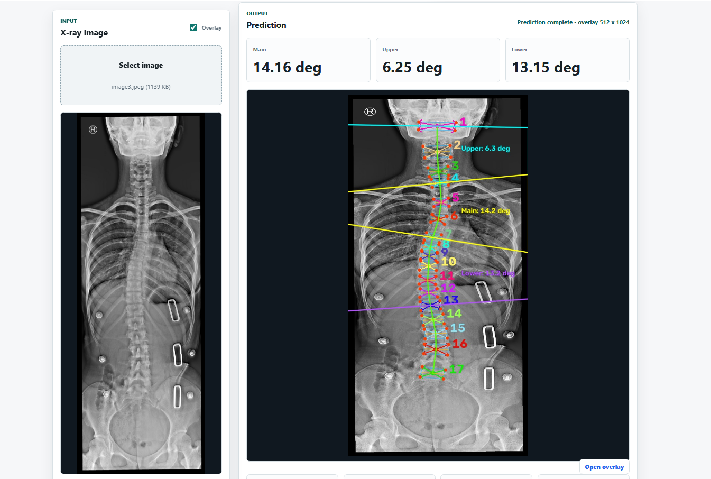

# Vertebra Landmark Detection

A research prototype for detecting vertebral landmarks in spinal X-ray images and estimating Cobb angles. The project includes a PyTorch model, a FastAPI backend, and a browser-based frontend for trying image inference.

> This project is a research prototype and is not intended for clinical diagnosis or treatment decisions.

## Features

- Detects vertebral landmarks in uploaded X-ray images.
- Estimates main, upper, and lower Cobb angles when landmarks are detected.
- Displays the prediction, vertebra summary, and optional image overlay in the frontend.
- Provides a FastAPI API and interactive API documentation.
- Runs on CUDA when available; otherwise, it uses CPU.

## Results

Example of the web frontend after image inference, showing the uploaded X-ray, detected landmarks, Cobb angle estimates, and overlay.



## Requirements

- Python 3.11 or newer
- [uv](https://docs.astral.sh/uv/)
- The model weights file at `Vertebra-Landmark-Detection/weights_spinal/model_last.pth` (included in the project folder)

## Start the app locally

Open a terminal in the repository root (`sollusis`) and change into the API project folder:

```powershell
cd .\Vertebra-Landmark-Detection
```

Install/synchronize the project dependencies:

```powershell
uv sync
```

Start the development server:

```powershell
uv run fastapi dev api.py
```

When the server is running, open **http://127.0.0.1:8000** in your browser to use the frontend. Keep the server running while using the page.

Other useful URLs:

- API documentation: http://127.0.0.1:8000/docs
- Alternative API documentation: http://127.0.0.1:8000/redoc
- Health check: http://127.0.0.1:8000/health

The health check initializes the inference service and reports the model device and expected input size.

## Using the frontend

1. Open http://127.0.0.1:8000.
2. Optionally click **Check** beside the API base URL to check the server.
3. Select an X-ray image (PNG, JPG, JPEG, or BMP).
4. Leave **Overlay** checked to include a rendered prediction overlay, or uncheck it to omit the overlay.
5. Click **Run inference** to view the detected landmarks and Cobb angle estimates.

## API

### `GET /health`

Checks that the inference service and model can be loaded. A successful response includes the selected device and model input dimensions.

### `POST /predict`

Accepts an image as multipart form data under the `file` field. Use the optional `include_overlay` query parameter to control whether the response includes an overlay image encoded as base64; it defaults to `true`.

Example with `curl`:

```bash
curl -X POST "http://127.0.0.1:8000/predict?include_overlay=true" \
  -F "file=@xray.jpg"
```

The JSON response includes Cobb angle estimates, detected landmarks and vertebrae, image dimensions, the inference device, and—when requested—the overlay image.

## Configuration

The inference service uses these optional environment variables:

| Variable | Default | Description |
| --- | --- | --- |
| `MODEL_WEIGHTS` | `weights_spinal/model_last.pth` | Path to the model checkpoint |
| `MODEL_DEVICE` | Automatically selected | Inference device, such as `cpu` or `cuda` |
| `MODEL_INPUT_H` | `1024` | Model input height |
| `MODEL_INPUT_W` | `512` | Model input width |
| `CORS_ORIGINS` | `*` | Comma-separated allowed browser origins |

## Project structure

```text
sollusis/
├── README.md
└── Vertebra-Landmark-Detection/
    ├── api.py                 FastAPI routes and frontend hosting
    ├── inference.py           Model loading and image inference
    ├── models/                PyTorch model architecture
    ├── weights_spinal/        Model checkpoint
    ├── frontend/              Browser frontend (HTML, CSS, and JavaScript)
    ├── train.py               Model training entry point
    ├── eval.py                Evaluation entry point
    └── test.py                Testing entry point
```

## Research reference

This project is based on the vertebra-focused landmark detection approach described in:

> Yi, J., Wu, P., Huang, Q., Qu, H., & Metaxas, D. N. “Vertebra-Focused Landmark Detection for Scoliosis Assessment.” ISBI, 2020. [arXiv:2001.03187](https://arxiv.org/abs/2001.03187).
